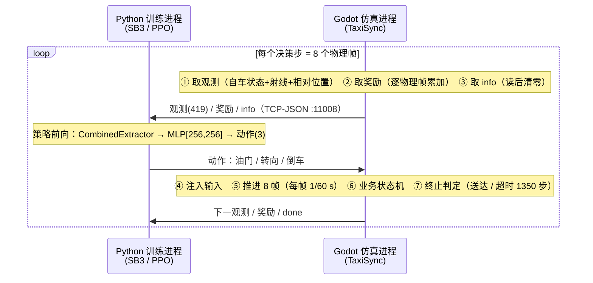
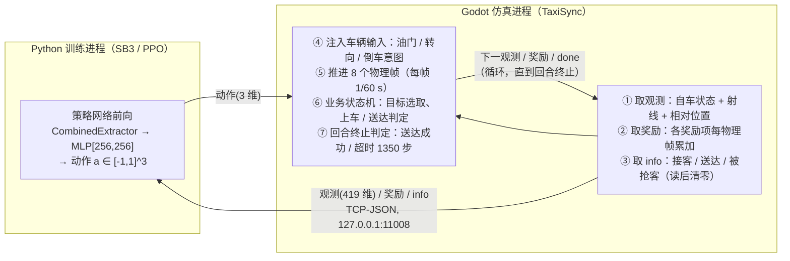
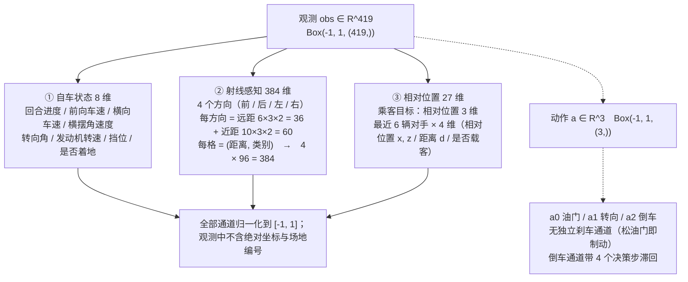
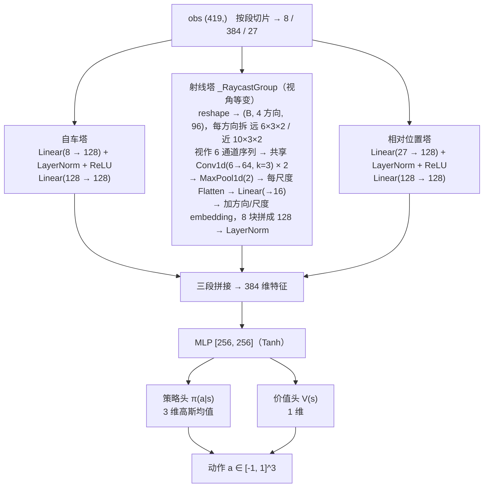
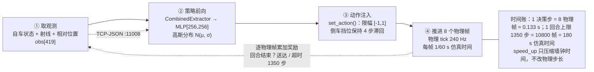
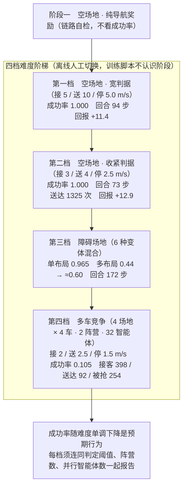

# 报告插图（Mermaid 源码 · 紧凑版）

> 用法：把代码块贴到 <https://mermaid.live>（或 draw.io「插入 → 高级 → Mermaid」、Typora、Obsidian、VS Code Mermaid 插件），
> 导出 **PNG/SVG** 后插进 Word 对应位置。图中维度与数字都与代码/训练日志一致。
>
> **压缩纵向长度的四个手法**（本文件已全部应用）：
> 1. **合并串联节点**：把「A→B→C→D」折成一个节点内部的多行文字，层级从 4 层降到 1 层；
> 2. **同层并列**：用 `A --> B & C & D` 或同层 subgraph，让三段观测/三座塔并排而不是串成一条线；
> 3. **换排布方向**：链条长、层级多的图用 `flowchart LR`（变宽不变高）；A4 纵向正文宽约 14.6 cm，横向图建议不超过 6 列；
> 4. **阈值/明细下沉**：判定阈值、归一化说明放进图注或脚注节点，节点内只留 2 行。
>
> 目标：每张图纵向 ≤ 12 行、层级 ≤ 4 层，插进正文后不超过半页。

---

## 图 2-1 系统总体架构（进程交互时序）

对应正文占位「系统总体架构（Godot 仿真层 / TCP-JSON / Python 训练层）」。A 时序图最紧凑也最清楚；B 双泳道版式更接近架构框图。

### A. 时序图（推荐，纵向最省）

### B. 双泳道流程图（每泳道折成 1 个节点，纵向仅 3 层）

---

## 图 2-2 观测与动作空间构成

对应正文占位「观测空间构成示意（8 维自车状态 + 384 维射线 + 27 维相对位置）」。三段并列（1 层）+ 动作 1 层，共 3 层。

---

## 图 3-1 分塔特征提取网络结构

对应正文占位「分塔特征提取网络结构图」。射线塔内部 7 步折进 1 个节点（保留关键层），三座塔并列，共 4 层。

> 若嫌这版仍偏高，可删掉每座塔的第二行 `Linear(128 → 128)`，只留 `Linear(in → 128) + LayerNorm + ReLU`。

---

## 图 3-2 决策步与物理帧时序关系

对应正文占位「一个决策步内的时序流程（取观测→策略前向→动作注入→推进 8 物理帧）」。改用 **LR**：四个阶段横排成 1 行，纵向只剩「主链 + 说明」两层。

> 想再短就把四格的第三行全部删掉，只留「① 取观测 / ② 策略前向 / ③ 动作注入 / ④ 推进 8 物理帧」，时间账并进图注。

---

## 图 4-1 分层课程与四档难度成功率

对应正文占位「分层课程与难度阶梯（四档成功率）」。每档压到 2 行、阈值用「接/送/停」缩写，四档共 8 行。

> 横向更省的写法：把 `flowchart TB` 改成 `flowchart LR`，四档横排（宽约 6 列，纵向只剩 3 行），适合放在页面上半部分。

---

## 画图时的几个坑

- **别把 `features_dim = 128` 当成网络输出**：128 是**每段**的维度，三段拼起来 384，MLP 输出的才是动作分布参数。
- **射线塔的 6 通道**是「3 行 × (距离, 类别)」，4 个方向是另一维，靠共享权重 + 方向 embedding 区分。
- **图 3-2 要强调「8 物理帧只产生 1 个决策」**；`speed_up=4` 加速的是墙钟时间，不改物理步长（踩过的坑）。
- **图 4-1 的四个成功率不能并列比较**：判据逐档收紧（5/10/5 → 3/4/2.5 → 2/2.5/1.5），所以阈值必须写进图里。
- **Mermaid 里 ` ` 是节点内换行**，纵向压缩主要靠它把串联节点折成一个节点；`&` 用于同层并列。
